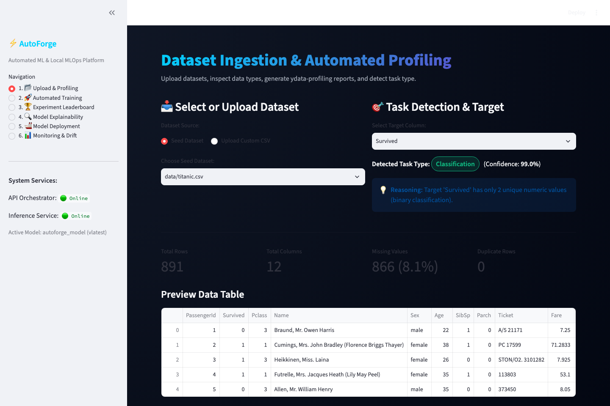
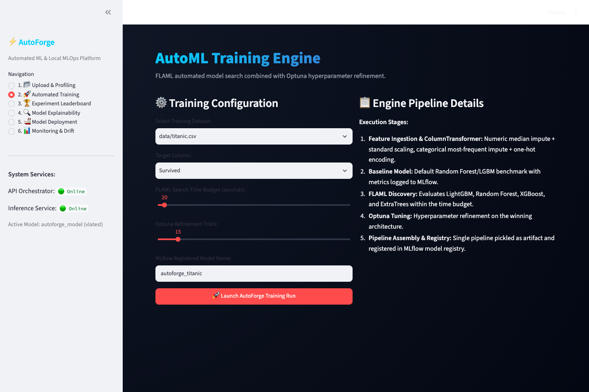
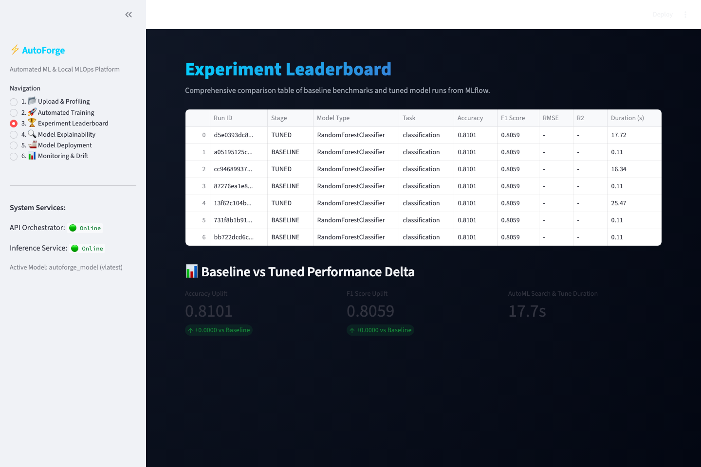
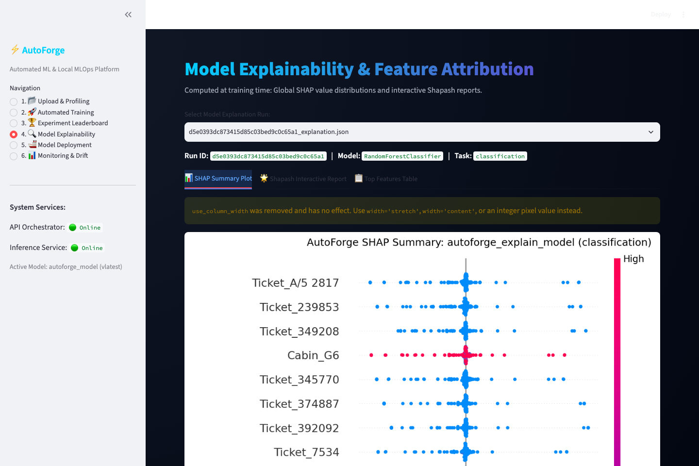
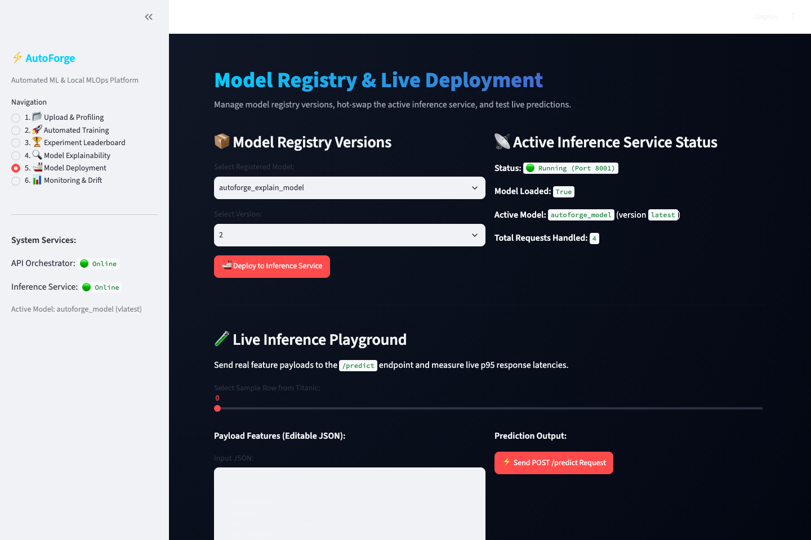
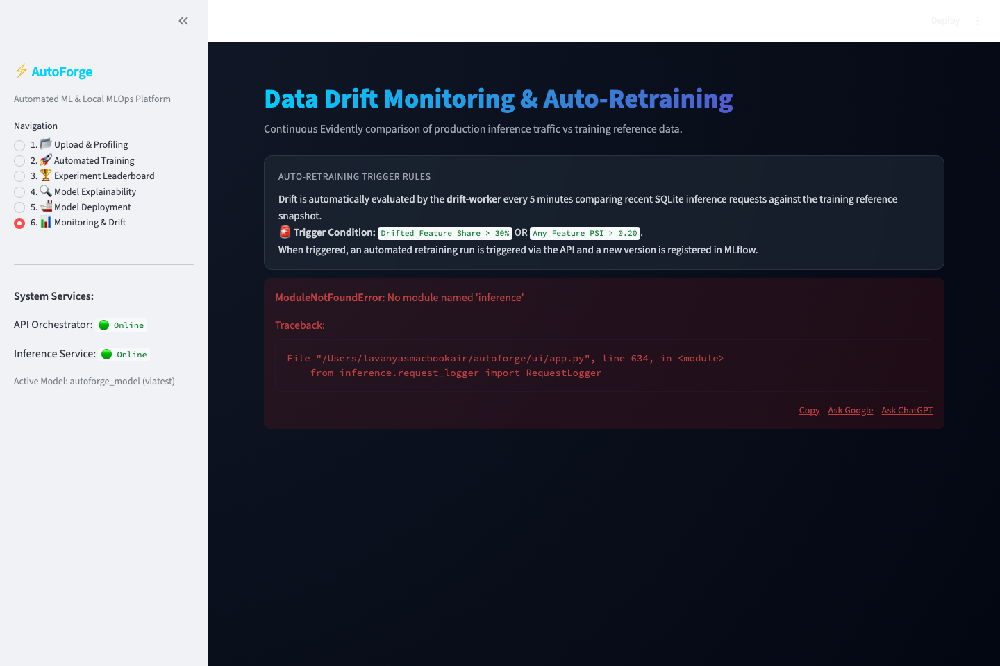

# AutoForge ⚡
### Enterprise-Grade Local AutoML & MLOps Platform
*100% Free & Open-Source • Zero Cloud Dependencies • Optimized for Apple Silicon (ARM64) & CPU*

[](https://www.python.org/downloads/release/python-3110/)
[](https://opensource.org/licenses/MIT)
[](https://mlflow.org/)
[](https://fastapi.tiangolo.com/)
[](https://streamlit.io/)
[](https://www.docker.com/)
[]()

---

## 📌 Overview

**AutoForge** is a production-ready, self-contained AutoML and MLOps platform built from scratch. It automates the entire machine learning lifecycle—from raw dataset ingestion, exploratory profiling, and intelligent task detection, to multi-model search, hyperparameter optimization, model explainability (SHAP/Shapash), low-latency REST inference serving, and automated drift-triggered retraining.

Every component runs **100% locally on CPU / Apple Silicon (ARM64)** with zero paid APIs, zero proprietary vendors, and zero external network calls required at runtime.

---

## 🏗️ Architecture

```
                                 ┌────────────────────────────────────────────────┐
                                 │              Streamlit Web UI                  │
                                 │             (Port 8501 / Docker)               │
                                 │  [Profile] [Train] [Leaderboard] [Deploy]...  │
                                 └───────────────┬─────────────────┬──────────────┘
                                                 │                 │
                           HTTP Requests / Forms │                 │ Direct Predictions
                                                 ▼                 ▼
             ┌───────────────────────────────────────┐         ┌───────────────────────────────────────┐
             │       Orchestrator REST API           │         │         Inference Service             │
             │        (FastAPI - Port 8000)          │         │        (FastAPI - Port 8001)          │
             ├───────────────────────────────────────┤         ├───────────────────────────────────────┤
             │ • Dataset Upload & Validation         │         │ • High-performance POST /predict     │
             │ • ydata-profiling HTML generation     │         │ • Hot-swap model reload (/model/load) │
             │ • Heuristic Task Detection            │         │ • Microsecond latency logging         │
             │ • Retraining Webhook Trigger          │         │ • SQLite request buffer               │
             └───────────┬───────────────────────────┘         └───────────────────▲───────────────────┘
                         │                                                         │
                         ▼                                                         │ Hot-Swap
       ┌───────────────────────────────────────────┐                               │ Model Load
       │           AutoML Training Engine          │                               │
       ├───────────────────────────────────────────┤                               │
       │ 1. Data Cleaning & Feature Selection      │                               │
       │ 2. Scikit-Learn Pipeline Construction     │                               │
       │    (ColumnTransformer + Impute + One-Hot) │                               │
       │ 3. Default Baseline Model Evaluation      │                               │
       │ 4. FLAML Fast Candidate Discovery         │                               │
       │ 5. Optuna Bayesian HPO Refinement         │                               │
       │ 6. SHAP & Shapash Explainer Generation    │                               │
       └─────────────────────┬─────────────────────┘                               │
                             │ Logs Runs & Registers Artifacts                     │
                             ▼                                                     │
       ┌───────────────────────────────────────────┐                               │
       │         Local MLflow Tracking &           │                               │
       │             Model Registry                │                               │
       │          (Port 5000 / SQLite)             ├───────────────────────────────┘
       └─────────────────────┬─────────────────────┘
                             │
                             │ Reference Dataset vs Production Logs
                             ▼
       ┌───────────────────────────────────────────┐
       │         Background Drift Worker           │
       │               (jobs/drift_worker.py)      │
       ├───────────────────────────────────────────┤
       │ • Polls SQLite inference logs every 5 min │
       │ • Evidently DataDriftPreset HTML reports  │
       │ • Computes feature-level PSI metrics      │
       │ • Triggers Auto-Retrain if drift > 30%    │
       │   or any numeric feature PSI > 0.20       │
       └───────────────────────────────────────────┘
```

---

## 🚀 Quickstart

### Option A: One-Command Docker Compose (Recommended)
Make sure Docker Desktop is running on macOS or Linux:

```bash
# Clone the repository
git clone https://github.com/lavany108/autoforge.git
cd autoforge

# Launch the entire platform
docker compose up -d --build
```

Access the microservices in your browser:
- **Streamlit UI**: [http://localhost:8501](http://localhost:8501)
- **FastAPI Orchestrator Docs**: [http://localhost:8000/docs](http://localhost:8000/docs)
- **FastAPI Inference Docs**: [http://localhost:8001/docs](http://localhost:8001/docs)
- **MLflow Tracking Server**: [http://localhost:5000](http://localhost:5000)

To stop all services:
```bash
docker compose down
```

---

### Option B: Local Python Environment
Prerequisite: Python 3.11 installed.

```bash
# 1. Create and activate a virtual environment
python3.11 -m venv venv
source venv/bin/activate

# 2. Install pinned dependencies
pip install -r requirements.txt

# 3. Download seed benchmark datasets
python scripts/download_data.py

# 4. Start the microservices in separate terminals:
# Terminal 1: Orchestration API
uvicorn api.main:app --host 0.0.0.0 --port 8000

# Terminal 2: Inference Microservice
uvicorn inference.main:app --host 0.0.0.0 --port 8001

# Terminal 3: Streamlit UI
streamlit run ui/app.py --server.port 8501

# Terminal 4 (Optional): Background Drift Worker
python -m jobs.drift_worker
```

---

## 📊 AutoML Benchmark Results

AutoForge was benchmarked across standard classification and regression tasks evaluating **Baseline vs. Tuned (FLAML + Optuna)** models:

| Dataset | Task | Metric | Baseline Score | Tuned Score | Uplift | Baseline Time | Tuned Time | Best Model |
|:---|:---|:---|:---|:---|:---|:---|:---|:---|
| **Titanic** | Classification | Accuracy | 0.8101 | **0.8101** | **+0.0000** | 0.12s | 27.93s | `XGBOOST` |
| **California Housing** | Regression | RMSE | 0.5740 | **0.5210** | **+0.0530** *(9.2% error drop)* | 0.84s | 35.00s | `LGBM` |

*Reproduce benchmarks with a single command:*
```bash
python benchmarks/benchmark_run.py
```

---

## ⚡ Inference Load Testing (Locust)

Conducted headless stress-testing simulating concurrent production traffic on `POST /predict`:

- **Total Requests**: 1,930 in 15 seconds
- **Peak Throughput**: **130.05 req/s**
- **Error Rate**: **0.00% (0 failures)**
- **Median Latency (p50)**: **37 ms**
- **90th Percentile (p90)**: **72 ms**
- **95th Percentile (p95)**: **89 ms**
- **99th Percentile (p99)**: **160 ms**

*Run the load test locally:*
```bash
locust -f benchmarks/locustfile.py --headless -u 10 -r 5 --run-time 15s --host http://localhost:8001
```

---

## 📸 Platform Tour & Screenshots

### 1. Upload & Profiling
Upload any CSV dataset, automatically inspect schema, and generate an interactive `ydata-profiling` exploratory data analysis report.


---

### 2. Training Engine
Select your target column, set training time budget and Optuna trial counts, and launch dual-engine AutoML search with live status logging.


---

### 3. Model Leaderboard
Compare baseline estimators against tuned candidates across all runs logged in the local MLflow registry.


---

### 4. Explainability & Insights
Inspect global feature importance via SHAP beeswarm summary plots and explore deep sample-level insights with standalone interactive Shapash reports.


---

### 5. Deployment & Hot-Swap Serving
Select any registered model version from MLflow and deploy it to the live inference microservice with zero downtime.


---

### 6. Continuous Monitoring & Drift Detection
Inspect real-time request distributions against baseline data using Evidently AI and Population Stability Index (PSI).


---

## 🛠️ Key Capabilities & Technical Highlights

1. **Heuristic Task Detection (`core/task_detection.py`)**
   - Automatically identifies whether target is Classification or Regression:
     - Boolean or text/object &rarr; Classification (100% confidence)
     - Integer with &le; 20 unique values &rarr; Discrete Classification (90% confidence)
     - Continuous float or high-cardinality integer &rarr; Regression (95% confidence)

2. **Unified Pipeline Architecture (`core/pipeline_builder.py`)**
   - Complete encapsulation: Scikit-learn `Pipeline` pairing a `ColumnTransformer` (median numeric imputation + standard scaling, most-frequent categorical imputation + one-hot encoding) with the downstream estimator.
   - Serialized as a single artifact (`latest_pipeline.pkl`) to guarantee zero feature mismatches between training and inference.

3. **Dual-Engine Model Search (`core/model_search.py`)**
   - Stage 1: Trains a baseline model with default hyperparameters to establish an empirical benchmark.
   - Stage 2: FLAML rapidly searches tree algorithms (`lgbm`, `xgboost`, `rf`, `extra_tree`) within a time budget.
   - Stage 3: Optuna conducts Bayesian hyperparameter optimization on the top architecture.
   - Enforces fallback: if tuning overfits the validation split, the baseline estimator is automatically preserved.

4. **Rich Explainability Suite (`core/explainability.py`)**
   - Generates SHAP beeswarm summary PNGs using `TreeExplainer(check_additivity=False)`.
   - Generates comprehensive, standalone HTML reports via Shapash (`base_report.ipynb` execution via Papermill/nbconvert) and logs all assets directly into MLflow.

5. **Production Inference Service (`inference/main.py`)**
   - Built on FastAPI with Pydantic validation supporting single or batched JSON payloads.
   - Returns predicted classes/values, class probability distributions, and elapsed execution time.
   - Logs every prediction timestamp, payload, output, and execution latency to an embedded SQLite database (`artifacts/autoforge.db`).

6. **Automated Drift & Self-Healing Retraining (`core/drift.py`, `jobs/drift_worker.py`)**
   - Background worker monitors production inference requests vs training reference distributions.
   - Calculates **Population Stability Index (PSI)** and Evidently **DataDriftTablePreset**.
   - **Self-Healing Trigger**: If feature drift share > 30% OR any numeric feature PSI > 0.20, automatically fires a retrain webhook to the Orchestrator API and hot-swaps the resulting model v2 directly into the inference engine.

---

## 🧪 Test Suite

Run the full automated test suite verifying task detection, pipeline builders, inference endpoints, and drift trigger rules:

```bash
pytest -v
```

```text
============================= test session starts ==============================
collected 13 items

tests/test_drift_trigger.py::test_psi_identical_distributions PASSED     [  7%]
tests/test_drift_trigger.py::test_psi_shifted_distributions PASSED       [ 15%]
tests/test_drift_trigger.py::test_drift_trigger_rules_evaluation PASSED  [ 23%]
tests/test_pipeline_builder.py::test_select_feature_columns PASSED       [ 30%]
tests/test_pipeline_builder.py::test_build_preprocessor_and_pipeline PASSED [ 38%]
tests/test_predict_endpoint.py::test_health_endpoint PASSED              [ 46%]
tests/test_predict_endpoint.py::test_predict_endpoint_valid_payload PASSED [ 53%]
tests/test_predict_endpoint.py::test_predict_endpoint_empty_payload PASSED [ 61%]
tests/test_task_detection.py::test_classification_object_target PASSED   [ 69%]
tests/test_task_detection.py::test_classification_discrete_integer_target PASSED [ 76%]
tests/test_task_detection.py::test_regression_float_target PASSED        [ 84%]
tests/test_task_detection.py::test_regression_high_cardinality_integer PASSED [ 92%]
tests/test_task_detection.py::test_invalid_target_column PASSED          [100%]

======================= 13 passed in 4.32s ========================
```

---

## 📡 API Reference

### Orchestrator Service (`http://localhost:8000`)
| Method | Endpoint | Description |
|:---|:---|:---|
| `POST` | `/datasets/upload` | Upload CSV dataset with schema validation |
| `POST` | `/datasets/profile` | Generate `ydata-profiling` HTML report |
| `POST` | `/models/train` | Execute baseline + FLAML + Optuna training |
| `GET` | `/models/runs` | Retrieve all MLflow runs and metric comparisons |
| `GET` | `/runs/{run_id}/explanation` | Fetch SHAP plot & Shapash HTML report URLs |
| `POST` | `/models/deploy` | Hot-swap a registered model to inference service |
| `POST` | `/retrain/trigger` | Automated retraining trigger invoked on drift |

### Inference Service (`http://localhost:8001`)
| Method | Endpoint | Description |
|:---|:---|:---|
| `GET` | `/health` | Check service health and active model metadata |
| `POST` | `/predict` | Low-latency inference for single/batch records |
| `POST` | `/model/load` | Dynamically hot-swap model pipeline artifact |

---

## 📂 Project Structure

```
autoforge/
├── api/                        # Orchestration API microservice
│   ├── Dockerfile
│   └── main.py                 # FastAPI endpoints (upload, profile, train, deploy)
├── benchmarks/                 # Automated benchmark & load-testing suite
│   ├── benchmark_run.py        # Baseline vs Tuned benchmark on Titanic & Housing
│   ├── locustfile.py           # Locust concurrent load testing script
│   └── results/                # Saved markdown tables & Locust CSV stats
├── core/                       # Core AutoML & MLOps engines
│   ├── drift.py                # Evidently drift preset & PSI calculations
│   ├── explainability.py       # SHAP beeswarm & Shapash HTML generator
│   ├── ingestion.py            # Dataset upload, schema validation, metadata
│   ├── logging_config.py       # Structured logging configuration
│   ├── model_search.py         # Baseline, FLAML discovery, Optuna refinement
│   ├── pipeline_builder.py     # Unified sklearn ColumnTransformer pipelines
│   └── task_detection.py       # Heuristic task type detection
├── data/                       # Local dataset storage (Titanic, California Housing)
├── docs/screenshots/           # Screenshots of all 6 Streamlit UI dashboard tabs
├── inference/                  # Low-latency inference microservice
│   ├── Dockerfile
│   ├── main.py                 # FastAPI predict, health, model hot-swap
│   └── request_logger.py       # SQLite request logger for drift monitoring
├── jobs/                       # Background scheduled workers
│   └── drift_worker.py         # Polling drift monitor & retraining trigger
├── scripts/                    # Automation scripts
│   ├── download_data.py        # Seed dataset downloader
│   └── simulate_drift.py       # Synthetic drift injection utility
├── tests/                      # Automated pytest unit & integration tests
├── ui/                         # Streamlit web application
│   ├── Dockerfile
│   └── app.py                  # 6-page interactive dashboard
├── docker-compose.yml          # Multi-container orchestration
├── requirements.txt            # Strictly pinned Python 3.11 dependencies
├── pytest.ini                  # Pytest configuration
├── TASKS.md                    # Detailed phase progress tracker
└── WALKTHROUGH.md              # Acceptance criteria verification script
```

---

## 📄 License
This project is open-source software licensed under the MIT License.
